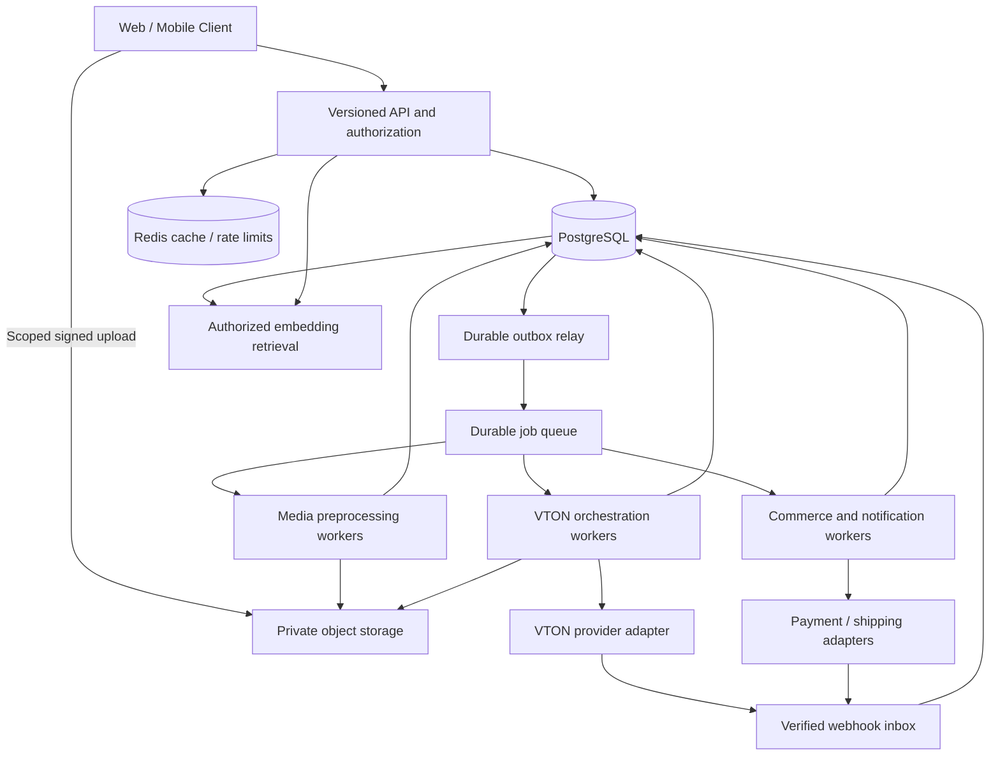

# Software Requirement Specification (SRS) & System Architecture
## Snapfit: Digital Wardrobe, Virtual Try-On & Pre-Loved Marketplace

- **Version:** 0.2 — expanded requirements and technical design
- **Updated:** 2026-10-12
- **Status:** Proposed implementation baseline; no application implementation is implied.
- **Scope:** Product requirements, service boundaries, data contracts, API behavior, operational targets, and acceptance criteria.

## 1. Product Objectives, Scope & Assumptions

Snapfit helps users organize clothes they own, create outfits, preview garments on their own photo, discover compatible purchases, and resell unused clothes. Recommendations should prioritize useful combinations from the existing wardrobe before introducing purchases.

### 1.1 Core objectives

1. **Digital wardrobe:** Upload, normalize, classify, search, and organize owned clothing.
2. **Virtual try-on (VTON):** Preview an authorized wardrobe, marketplace, or catalog garment on a user's photo.
3. **Outfit discovery:** Save outfits and recommend compatible items using metadata and visual similarity.
4. **Circular commerce:** Convert wardrobe items into pre-loved listings with safe reservation, payment, delivery, and dispute workflows.
5. **Credit economy:** Charge once for a successfully delivered new generation; eligible cached results are free.

### 1.2 Planning assumptions

These are design defaults, not confirmed business decisions. Section 12 records decisions that must be resolved before the affected feature launches.

| Topic | Proposed baseline |
| --- | --- |
| Launch market | Malaysia; MYR only for initial commerce |
| Client | API supports mobile and web; initial client platform remains a product decision |
| Accounts | Google and Apple sign-in; no password authentication in initial scope |
| VTON | One garment per generation initially; multi-garment/layered outfits require a capability evaluation |
| Credit charge | One credit per successful new generation; no charge for failed or cancelled jobs |
| Welcome credits | Five credits, granted once through the ledger; configurable and abuse-controlled |
| Marketplace | One physical item per listing and one listing per order initially |
| Marketplace fees | Configurable and versioned; 8% is an example, not an approved rate |
| Payment custody | Provider-supported delayed settlement/payout; do not describe it as escrow without a verified escrow service |
| Delivery | Tracked shipping initially; carrier integration and geographic coverage require confirmation |
| Age eligibility | Proposed adults-only launch; eligibility rules must be confirmed before onboarding ships |

### 1.3 Delivery phases and exclusions

- **Phase 1 — Wardrobe and VTON:** Accounts, consent, secure media, wardrobe CRUD, preprocessing, credits, asynchronous single-garment VTON, history, deletion, and operational controls.
- **Phase 2 — Discovery:** Saved outfits, outfit planning, explainable matching, affiliate ingestion, stock/price freshness, and recommendation feedback.
- **Phase 3 — Marketplace:** Listings, reservations, seller onboarding, checkout, shipping, disputes, refunds, payouts, moderation, and seller reviews. Release only after payment and operational gates pass.
- **Later enhancements:** Wear tracking, resale prompts, supported multi-garment generation, and advanced personalization.
- **Excluded initially:** Guaranteed size/fit prediction, cross-border selling, multi-item carts, direct buyer/seller chat, and a general social feed. VTON previews estimate appearance and must not claim physical fit accuracy.

## 2. Actors & Authorization

| Actor | Permissions |
| --- | --- |
| Guest | Browse published catalog and listings, subject to rate limits; no private photos or wardrobe access |
| User / buyer | Manage own wardrobe, photos, credits, outfits, generations, purchases, and privacy requests |
| Seller | User permissions plus own listings, fulfillment, disputes, and provider-approved payouts |
| Moderator / support | Scoped access to reports and cases; private body photos unavailable by default |
| Finance operator | Scoped reconciliation, refund, and payout actions with audit records and step-up authentication |
| Worker / integration | Service identity with only the storage, queue, and database permissions needed for its task |

All resource access shall enforce ownership or an explicit sharing policy on the server. Knowing a UUID, object key, cache key, or provider request ID shall not grant access. Administrative roles shall be independently assigned, auditable, and revocable.

## 3. Functional Requirements

### FR-1: Identity, sessions & account lifecycle

- **FR-1.1:** Authenticate using Google/Apple OpenID Connect. Validate issuer, audience, signature, expiry, nonce, and flow state; use PKCE where applicable. Identify accounts by provider issuer and subject, not email alone.
- **FR-1.2:** Issue short-lived access tokens and rotating refresh sessions. Support logout, logout-all, session listing, refresh reuse detection, and revocation after suspension or deletion.
- **FR-1.3:** Account linking requires authenticated proof of both identities. Matching email addresses alone shall not silently merge accounts. Support provider relay addresses and unavailable email claims.
- **FR-1.4:** Maintain profile, locale, timezone, optional style preferences, and versioned consent records. Style preferences shall be editable and removable.
- **FR-1.5:** Support account export and deletion with visible request status. Revoke sessions immediately, block new jobs and purchases, and process deletion as described in Section 9. Active orders and required transaction retention shall follow an explicit policy rather than blanket cascading deletion.
- **FR-1.6:** Enforce account status and configured eligibility at protected endpoints. Welcome-credit abuse controls shall not rely on email uniqueness alone.

### FR-2: Credit wallet, purchases & accounting

- **FR-2.1:** Keep an append-only ledger for grants, purchases, reservations, captures, releases, reversals, and audited adjustments. A mutable balance alone is insufficient.
- **FR-2.2:** Maintain posted balance and reserved credits. Available credits equal posted balance minus reserved credits; neither posted balance nor available credits may become negative in ordinary spending.
- **FR-2.3:** Reserve one credit atomically when accepting a new VTON job. Capture only after the result is validated and persisted in application-owned storage. Release on terminal failure or cancellation. Provider costs caused by failed internal retries are not additional user charges.
- **FR-2.4:** Use unique business operation keys so concurrent requests, retries, and duplicate callbacks cannot grant or spend twice. A retry of the same request returns the original outcome.
- **FR-2.5:** Grant purchased credits only after server-side provider verification. A browser redirect is not payment confirmation. Handle duplicate, delayed, and out-of-order payment events.
- **FR-2.6:** Show wallet balance, reserved credits, and paginated transaction history with understandable reasons. Reconcile wallet projections against the ledger on a scheduled basis and alert on differences.
- **FR-2.7:** Refund/chargeback policy for credit purchases shall define how unused credits are reversed. If credits have already been spent, create a finance case and apply an explicit account policy; do not silently violate wallet invariants.

### FR-3: Media upload & digital wardrobe

- **FR-3.1:** Support JPG, PNG, and HEIC input. Proposed upload limits: 15 MiB and 40 megapixels per image; validate actual decoded content and dimensions, not filename or client MIME type.
- **FR-3.2:** Upload into a private quarantine prefix using narrowly scoped signed upload authorization. Validate upload size/checksum, normalize orientation, strip EXIF/location metadata, and isolate image decoding with memory/time limits before promotion.
- **FR-3.3:** Isolated preprocessing workers remove backgrounds and generate an aspect-preserving, centered 1024 × 1024 transparent PNG plus thumbnails. Record preprocessing version, status, attempts, and failure reason.
- **FR-3.4:** Infer category, color family, and formality with confidence scores. Preserve separate inferred and user-overridden metadata; reprocessing shall not overwrite manual choices.
- **FR-3.5:** Support create, view, edit, archive/delete, search, filters, and cursor pagination. Store optional brand, size label/system, measurements, material, notes, and multiple item photos.
- **FR-3.6:** User body photos are separate private assets with explicit consent for inference. Provide capture guidance and actionable validation for framing, lighting, occlusion, and unsupported inputs before reserving credits.
- **FR-3.7:** Marketplace publication creates a deliberately selected public garment image derivative. It shall not expose private wardrobe notes, body photos, original uploads, or unrelated wardrobe items.
- **FR-3.8:** Replacing an image creates an immutable new asset version. Dependent cutouts, embeddings, and cache references shall be regenerated or invalidated.

### FR-4: Catalog & affiliate discovery

- **FR-4.1:** Ingest only authorized partner feeds/APIs. Involve Asia, Shopee, Zalora, and Nike are candidate partners; availability, permissions, image use, and VTON rights require verification.
- **FR-4.2:** Deduplicate by partner and external product/variant identifiers. Store brand, category, size variants, currency, price, stock, merchant, source URL, source timestamps, and last successful synchronization.
- **FR-4.3:** Run incremental ingestion with checkpoints, retries, validation, and feed health reporting. Proposed initial schedule: every six hours; products older than 24 hours without successful freshness confirmation are marked stale and excluded from purchase recommendations.
- **FR-4.4:** Generate affiliate links server-side using partner-approved attribution fields. Validate destinations against configured merchant domains, disclose affiliate relationships, and avoid putting personal data in tracking parameters.
- **FR-4.5:** Explain that merchant checkout governs final price and availability. External affiliate purchases do not create local marketplace orders or credit wallet entries.
- **FR-4.6:** Collect only approved attribution events; define click/conversion retention and consent before analytics launch.

### FR-5: VTON, cache & generation history

- **FR-5.1:** Accept an owned body-photo asset ID and typed garment references: `wardrobe`, `listing`, or `catalog`. The API shall resolve authorized immutable media versions server-side; clients cannot supply arbitrary fetch URLs.
- **FR-5.2:** Validate all inputs and model-supported categories before credit reservation. Initially accept exactly one garment; reject unsupported combinations explicitly rather than silently dropping garments.
- **FR-5.3:** Return a persistent job ID with `202 Accepted` for new work. Support status retrieval, history, user cancellation, and optional authenticated event notifications; polling remains available.
- **FR-5.4:** Cache lookup shall use a versioned canonical hash containing user scope, normalized photo checksum, garment checksums/source versions, preprocessing version, provider/model version, and all output-affecting parameters. Ordered layers remain ordered if later supported.
- **FR-5.5:** Return an eligible cached result at zero credit cost. Redis is an accelerator; persistent result metadata remains authoritative. An evicted Redis entry does not justify charging for an otherwise eligible stored result.
- **FR-5.6:** Deduplicate identical active requests per user and generation signature. A new idempotency key for identical in-flight work returns the existing job and creates no extra reservation.
- **FR-5.7:** Track provider request IDs, attempts, deadlines, and safe error codes. Retry transient failures with bounded backoff; do not blindly resubmit after an ambiguous provider timeout. Reconcile provider status first or use provider-supported idempotency.
- **FR-5.8:** Persist successful outputs privately, validate readability, and finalize the job and credit capture once. Offer result deletion, download authorization, and quality feedback. Sharing requires an explicit user action and revocable share authorization.
- **FR-5.9:** Never reuse one user's body-photo result for another user. Reject deleted, expired, unauthorized, or invalidated cache entries. Provider fallback is allowed only if consent, capability, and the versioned signature support it.
- **FR-5.10:** Display expected cost before submission and a clear appearance-estimate notice. “Regenerate” must explicitly select a new generation variant/seed and disclose its cost; accidental repeated taps shall reuse the original operation.

### FR-6: Outfits & matching engine

- **FR-6.1:** Save named outfits containing ordered item references, source versions, occasion, and optional planned date. Unavailable items shall be flagged without erasing the outfit.
- **FR-6.2:** Recommend owned combinations first; optionally include marketplace/catalog candidates under a user-selected MYR budget. Filter unauthorized, sold, stale, out-of-stock, and incompatible-category candidates before ranking.
- **FR-6.3:** Combine versioned visual embeddings with explicit category, color, formality, occasion, and optional size rules. Budget comparisons use the same currency; cross-currency matching is outside initial scope.
- **FR-6.4:** Define scoring weights in configuration, expose brief truthful reasons such as “matches your navy trousers,” and record algorithm version for evaluation. Cold-start users receive rule-based suggestions and onboarding prompts.
- **FR-6.5:** Support like, dismiss, save, and poor-match feedback. Evaluate relevance, wardrobe reuse, diversity, and purchase conversion separately so affiliate incentives do not override user preferences.
- **FR-6.6:** Store embedding model/version, dimension, asset checksum, and index status. Re-index on image replacement or model migration; enforce private wardrobe access during candidate retrieval.

### FR-7: Listings & reservation

- **FR-7.1:** Publish a wardrobe item only after checking ownership, processing readiness, moderation, and required title, description, size/system, condition, price, and public photos. Condition and defects must be represented separately.
- **FR-7.2:** Permit one open listing per wardrobe item. Seller edits are versioned; reserved or purchased commercial terms cannot change. Archiving a wardrobe item shall not erase a listing or purchase record.
- **FR-7.3:** Provide searchable listings with category, size, condition, price, and location filters. Buyer VTON uses only the approved listing derivative; sellers cannot access buyer photos or results.
- **FR-7.4:** Reserve a listing transactionally for a buyer with an expiry. Proposed checkout window: 15 minutes. Reject self-purchases and concurrent competing reservations.
- **FR-7.5:** Payment initiation/expiry coordination shall prevent reuse of an item while payment status is uncertain. Late successful payments without a valid sale claim enter refund/reconciliation handling and shall never create a second sale.

### FR-8: Marketplace payments, fulfillment & disputes

- **FR-8.1:** Use a verified marketplace-capable provider flow with seller onboarding, supported payment methods, payout account verification, and documented country eligibility. Do not assume Stripe and ToyyibPay expose equivalent capabilities.
- **FR-8.2:** Snapshot listing description, size, condition, price, currency, fee-policy version, shipping charge, and delivery address at order creation. Calculate monetary amounts server-side in integer minor units.
- **FR-8.3:** Separate order, payment, shipment, refund, dispute, transfer, and payout states. Persist provider references and durable webhook events. Client-supplied status changes cannot mark payment as paid.
- **FR-8.4:** Support seller shipping confirmation, tracking, delivery evidence, notifications, cancellation rules, shipment deadlines, and lost/undelivered item handling. Do not treat shipment creation as delivery.
- **FR-8.5:** Release funds only after verified delivery and the configured buyer review window, with no blocking dispute or refund. Proposed review window: 48 hours; seller shipping deadline: three business days using the configured Malaysian business calendar.
- **FR-8.6:** Snapshot commission and rounding policy. Explicitly define who pays shipping, processor fees, refunds, and chargebacks. Track gross collections, refunds, fees, seller transfers, and external payouts separately.
- **FR-8.7:** Support item-not-received and item-not-as-described disputes, evidence uploads, return approval, tracking, full/partial refunds where supported, and audited operator resolutions.
- **FR-8.8:** Reconcile provider collections, refunds, transfers, and payouts daily. Failed payouts remain visible and retryable under policy; a scheduled transfer is not proof of successful external payout.
- **FR-8.9:** If a post-payout refund or chargeback occurs, record the loss/recovery obligation and use the provider-supported reversal or recovery flow. Never silently release another seller's funds to cover it.

### FR-9: Trust, support & notifications

- **FR-9.1:** Support reporting listings/users, moderation queues, removal reasons, appeals, and blocking where relevant. Establish prohibited-item, counterfeit, and generated-content policies before public listings launch.
- **FR-9.2:** Allow one verified-purchase seller review per completed order, with moderation and seller response policy. Prevent sellers from reviewing themselves.
- **FR-9.3:** Send durable in-app notifications for generation outcomes, purchases, shipping, disputes, refunds, and payouts. Email/push delivery is asynchronous, retryable, and independent of financial finalization.
- **FR-9.4:** Provide scoped operator tools for job diagnosis, ledger reconciliation, deletion requests, and dispute resolution. Financial corrections require a reason and append-only audit entry.

## 4. Non-Functional Requirements & Proposed Service Targets

Targets below are initial engineering acceptance targets, not measured capabilities. Validate them against the selected infrastructure, providers, and representative traffic before promising them externally.

| ID | Requirement / proposed target | Measurement |
| --- | --- | --- |
| NFR-1 | Core API monthly availability ≥99.5% | External probes; provider generation availability reported separately |
| NFR-2 | CRUD/search API p95 ≤500 ms; VTON submission p95 ≤1 s | Excludes image transfer and model execution; test with 100 concurrent active clients and 10,000 owned items/catalog candidates in fixtures |
| NFR-3 | Preprocessing p95 ≤30 s; single-garment VTON p95 ≤120 s | End-to-end queue plus execution under agreed load; provider benchmarks required |
| NFR-4 | No duplicate user charges or double-sales under retries/concurrency | Transaction and fault-injection acceptance tests |
| NFR-5 | Private data encrypted in transit and at rest; least privilege | Deployment configuration and authorization tests |
| NFR-6 | API/worker restarts lose no accepted jobs or confirmed payments | Durable outbox/inbox, redelivery and restart tests |
| NFR-7 | Database recovery point ≤15 min; recovery time ≤4 h | Backup/PITR configuration and quarterly restore exercise; include object references and media recovery |
| NFR-8 | Proposed private-photo and result deletion within 30 days | Deletion audit; retained transaction exceptions separately documented |
| NFR-9 | Accessible controls, validation, keyboard/focus behavior, and alternatives to image-only status | Client acceptance review against the agreed accessibility standard |
| NFR-10 | Track cost per successful VTON, retries, storage, and cache hits | Provider/model dashboards and budget alerts; configurable concurrency and daily spend caps |
| NFR-11 | Malaysia-first localization: MYR, configurable size systems, timezone-aware notifications | Locale fixtures; persist instants in UTC and render in user timezone |

When a spend cap or provider outage prevents accepting new work, reject before credit reservation or release the reservation through the normal terminal-failure flow. Previously accepted jobs remain recoverable and visible.

## 5. System Architecture & Technical Boundaries

### 5.1 Component view



### 5.2 Deployment baseline

Use a modular API application with separately deployed workers. Start with one authoritative PostgreSQL database and explicit module ownership; independent microservices are not required for the initial product. The application language/framework, queue implementation, cloud, and hosting region remain recorded decisions in Section 12.

| Module | Responsibilities / owned data |
| --- | --- |
| Identity | Users, identities, refresh sessions, roles, consent |
| Media / wardrobe | Upload authorization, validation, immutable assets, cutouts, item metadata |
| Credits | Wallet projections, immutable entries, reservations, purchase fulfillment |
| VTON | Job orchestration, provider adapters, result eligibility, history |
| Discovery | Feed ingestion, catalog freshness, embeddings, outfits, ranking |
| Commerce | Listings, reservations, orders, payments, refunds, shipping, payouts |
| Operations | Moderation, notifications, audit, reconciliation, deletion |

- **PostgreSQL:** Authoritative domain state, financial transactions, durable jobs, webhook inbox, and transactional outbox. Row locks/constraints enforce accounting and listing invariants.
- **Redis:** Optional cache, rate limiting, and advisory coordination. Loss of Redis shall not lose balances, orders, jobs, or durable result eligibility.
- **Object storage:** Private immutable originals, normalized images, cutouts, and VTON results; approved listing derivatives may use a separate public distribution path.
- **Queue:** At-least-once delivery with visibility leases, bounded retries, and a dead-letter queue. Workers shall tolerate redelivery; no exactly-once delivery assumption.
- **Embeddings:** Prefer a PostgreSQL vector extension if hosting supports it and benchmarks pass; otherwise use a dedicated index. The relational ownership/version record stays authoritative. Select dimension and index strategy after choosing the embedding model.
- **Provider adapters:** Normalize capabilities, submission, status, cancellation, webhook verification, output retrieval, and error classification. Keep credentials server-side in a secrets manager.

### 5.3 Reliable events & integration security

1. Commit state changes and an outbox event in the same database transaction.
2. Relay events to the queue; acknowledge only after delivery. Duplicate publication is acceptable because consumers are idempotent.
3. Verify webhook signatures and replay windows using provider-specific rules; where signed callbacks are unavailable, authenticate and re-fetch authoritative provider state before applying effects.
4. Store a deduplicated inbox event before acknowledging receipt. Process it asynchronously; acknowledge duplicates without applying duplicate effects.
5. Validate event amount, currency, account, business reference, and allowed state transition. Re-fetch state for ambiguous/out-of-order events.
6. Restrict outbound image fetching to trusted storage/provider hosts, block private-network destinations and unsafe redirects, and limit response size/time. Never log signed URLs or secrets.

## 6. Data Model & Database Invariants

### 6.1 Modeling rules

This section replaces the original illustrative DDL with an expanded logical schema contract. It is not an executable migration. Implementation migrations must translate every required key, constraint, index, and transition rule, then be validated against PostgreSQL before application development depends on them.

- Use UUID primary keys and `TIMESTAMPTZ` for instants. Use `DATE` for local outfit-planning dates with a recorded user timezone.
- Required ownership and business-reference fields are `NOT NULL` unless explicitly stated otherwise.
- Store MYR amounts as `BIGINT` sen with non-negative constraints and a three-letter currency code. Use explicit rounding when calculating percentage fees; never floating-point money.
- Use constrained status values and conditional transition updates. A status column alone does not implement a state machine.
- Store object keys and checksums, not durable public/signed URLs. Generate temporary access URLs after authorization.
- Financial and order records use restricted deletion plus controlled anonymization; ephemeral private data may cascade only through a reviewed lifecycle.
- Index foreign keys and actual access paths. Use owner-scoped `(user_id, created_at, id)` indexes for cursor pagination.

### 6.2 Required entities

| Entity | Required fields and constraints |
| --- | --- |
| `users` | `id`, optional contact email, display name, locale, timezone, `status`, created/updated/deletion timestamps. Email is contact data, not the federated identity key. |
| `auth_identities` | `user_id`, `issuer`, `subject`, provider; unique `(issuer, subject)`; no stored provider token unless explicitly needed and encrypted. |
| `refresh_sessions` | `user_id`, token hash, session family, expiry, revoked timestamp, limited device metadata; unique token hash. |
| `user_roles` | `user_id`, role, grantor, granted/revoked timestamps; constrain active grants. |
| `consent_records` | `user_id`, purpose, policy version, granted/revoked timestamps, collection context. |
| `media_assets` | Owner, purpose, private object key, immutable version/checksum, MIME, dimensions, byte size, validation status, retention/deletion timestamps; unique object key. Public derivatives have explicit publication metadata. |
| `media_processing_jobs` | Asset/item references, pipeline version, status, attempts, next attempt, lease/deadline, error code, output asset references. |
| `user_wardrobe` | Owner, category, inferred metadata/confidence, user overrides, brand, size/system, optional measurements/material/notes, status, created/updated timestamps. |
| `wardrobe_item_media` | Item, asset, role, position; unique `(item_id, role, position)`; verify item and private asset ownership. |
| `user_credit_wallets` | One per user; `posted_balance`, `reserved_credits`, version; check `posted_balance >= reserved_credits >= 0`. |
| `credit_ledger_entries` | User, kind, signed posted delta, signed reserved delta, business reference, unique operation key, reason/actor, timestamp; append-only. Sum of deltas equals wallet projection. |
| `credit_reservations` | User, job, amount, status (`held`, `captured`, `released`), expiry/reconciliation deadline; unique job; exactly one terminal outcome. |
| `credit_purchases` | User, pack/version, credit quantity, amount/currency, provider/payment reference, fulfillment/refund state; unique provider payment reference. |
| `affiliate_products` | Partner, external product/variant ID, title, brand, category, merchant, canonical destination, current price/currency, stock, source version and freshness timestamps; unique partner/product/variant key. |
| `catalog_product_media` | Product, authorized asset/reference, source checksum/version, processing and image-use status. |
| `item_embeddings` | Typed source ID, owner scope where private, asset version/checksum, model/version/dimension, index status and vector or index reference; unique source/version/model key. |
| `outfits` / `outfit_items` | Owner, name, occasion, optional planned date/timezone; ordered typed source references and version snapshots; prohibit unauthorized private references. |
| `recommendation_events` | User, candidate IDs, algorithm version, reason codes, feedback/action, timestamp, retention policy; avoid raw private image data. |
| `vton_jobs` | User, versioned request hash, generation variant, immutable input manifest, model/provider version, status, cost, attempt/lease/deadline, optional result ID, cancellation/error timestamps. |
| `vton_attempts` | Job, attempt number, provider, optional provider request ID, submission state, status, cost telemetry and deadlines; unique `(job_id, attempt_number)` and provider request ID when present. |
| `vton_results` | User, request hash, private output asset, model/version, eligibility status, expiry/invalidation timestamps. At most one reusable result per user/signature; keep historical generations separately. |
| `vton_history` | User, job/result, delivery type (`new`, `cached`), credits charged, timestamp; multiple history rows may reference one result. |
| `vton_feedback` / `result_shares` | Owner/result, feedback category; or revocable share token hash, expiry and access policy. No implicit public result URL. |
| `seller_accounts` | User, provider account reference, onboarding/capability states, payout restrictions, last verification timestamp; provider holds sensitive payout details where possible. |
| `marketplace_listings` | Seller, optional retained wardrobe reference, public asset references, title, description, category, size/system, condition, defects, amount/currency, version, status and moderation state. |
| `listing_reservations` | Listing, buyer, order reference, expiry, status, payment-resolution state; at most one active reservation per listing. |
| `marketplace_orders` | Buyer, seller, listing, reservation, immutable item/address/pricing snapshots, fee-policy version, order state, timestamps; buyer differs from seller. |
| `marketplace_sales` | Unique listing ID and unique successful order ID; persistent sale claim prevents another sale even after refund. Relisting a returned item creates a new listing. |
| `payments` / `payment_events` | Order or credit-purchase reference, provider object/event IDs, amount/currency, normalized state, timestamps; unique provider IDs and event IDs; exactly one business purpose per payment. |
| `refunds` / `seller_transfers` / `payouts` | Business reference, provider ID, amount/currency, operation key, status/reason/timestamps. Transfers and external bank payouts are separate records; batch payouts have an allocation table. |
| `commerce_ledger_entries` | Immutable movement records for collections, shipping, commission, processing fees, refunds, transfers, payouts, reversals and chargebacks; currency, amount, accounts and unique business operation. |
| `shipments` | Order, carrier, tracking ID, event-derived shipment status, ship/delivery timestamps and evidence; unique carrier event references. |
| `disputes` / `dispute_evidence` | Order, claimant, reason, state, deadlines, operator decision, return/refund references, private evidence assets. |
| `seller_reviews` | Completed order, buyer, seller, rating/comment/moderation state; unique order review; buyer/seller validated against order. |
| `reports` / `moderation_actions` | Reporter, target type/ID, reason, state, operator and audit references. |
| `notifications` / `notification_deliveries` | Recipient, business event key, template/payload reference, channel, delivery attempts/status; deduplicate recipient/event/channel. |
| `webhook_inbox` | Provider, external event ID, verification status, protected payload/reference, processing status, retries; unique `(provider, external_event_id)`. |
| `outbox_events` | Event ID, aggregate ID/type, schema version, payload/reference, created/published timestamps, attempts. |
| `idempotency_records` | Principal, route, key, request digest, operation ID, outcome/response reference, expiry; unique principal/route/key. |
| `audit_events` | Actor/service, action, target, reason, correlation ID, timestamp and redacted changes; append-only with restricted access. |
| `deletion_requests` / `deletion_tasks` | User, status, requested/deadline timestamps, per-system task status, retained-record reasons, completion proof without deleted content. |
| `feed_sync_runs` | Partner, cursor/checkpoint, start/end, counts, validation errors and status. |

Typed source references shall be validated against their concrete source tables and authorization rules. Prefer concrete association tables/foreign keys in migrations; a generic `source_type/source_id` pair alone is not referential integrity.

### 6.3 Critical constraints & transaction boundaries

1. Wallet row lock, ledger append, reservation update, job creation/finalization, and outbox write occur in one transaction for each financial transition. Application runtime roles cannot update/delete ledger entries directly.
2. Wallet transitions: grant/purchase `(+N, 0)`; reserve `(0, +1)`; capture `(-1, -1)`; release `(0, -1)`. A captured reservation cannot later release. Reversal is a new compensating entry.
3. A partial unique index enforces one active VTON job per `(user_id, request_hash)` across `queued`, `submitting`, `running`, and `cancel_requested`. Another enforces one eligible result per user/signature. Idempotency records are independent of reusable results/history.
4. A partial unique index enforces one listing in `draft`, `active`, or `reserved` per non-null wardrobe item. Listing ownership must match wardrobe ownership when linking.
5. Lock listing/reservation/order rows in a documented consistent order before taking a reservation or applying payment. A partial unique index enforces one active listing reservation; `marketplace_sales` enforces one sale claim per listing.
6. Reservation expiry is an explicit transition handled by a worker, not an index predicate using the current clock. Payment uncertainty blocks re-reservation until reconciled or the payment intent is safely cancelled.
7. Order snapshot amounts cannot change after payment initiation. Refunds cannot exceed captured funds less prior refunds. Transfers cannot exceed the eligible seller amount, accounting for disputes and reversals.
8. Privacy deletion does not cascade through financial records. Use anonymized actor references and retain only policy-required transactional fields; purge delivery addresses when their separate retention expires.
9. Durable event payloads should contain identifiers rather than raw photos or unnecessary personal data, so deletion can complete without breaking delivery/reconciliation.

## 7. State Machines & Failure Handling

### 7.1 VTON lifecycle

```text
queued -> submitting -> running -> succeeded
queued -> cancelled
submitting / running -> cancel_requested -> cancelled
queued / submitting / running / cancel_requested -> failed
cancel_requested -> succeeded   (only if success finalization won the race)
```

- Persist submission intent before the provider call and provider request ID immediately afterward. If the process dies in between, reconcile via a client reference/idempotency capability. If the provider cannot resolve ambiguous submissions, do not auto-resubmit; route to reconciliation with a bounded user-facing deadline.
- Proposed queue deadline: five minutes; execution deadline: ten minutes. On unresolved timeout, fail the user job, release its credit, and quarantine late outputs. Provider reconciliation may continue without charging the user.
- Cancellation and success finalization compete through a locked/conditional state transition. If cancellation wins, release the credit and discard late output. If success wins, capture once and return the completed status.
- Persist output before the finalization transaction; clean orphaned uploads if finalization fails. Retry finalization idempotently, without another inference.
- Backoff uses jitter and at most three safe transient retries. A dead-letter item remains attached to a visible failed/reconciling business operation and an operator alert.

### 7.2 Commerce lifecycles

| Aggregate | Normal flow | Exceptional outcomes |
| --- | --- | --- |
| Listing | `draft -> active -> reserved -> sold` | `reserved -> active` only after safe release; `active -> delisted`; moderation may suspend publication |
| Reservation | `active -> converted` | `active -> payment_uncertain -> converted/released`; safe unpaid expiry -> `expired` |
| Order | `pending_payment -> paid -> fulfilling -> shipped -> delivered -> completed` | `cancelled`, `disputed`, `return_pending`, `returned`; financial state tracked separately |
| Payment | `pending -> processing -> succeeded` | `failed`, `cancelled`; refund and chargeback tracked as separate aggregates |
| Refund | `requested -> processing -> succeeded` | `failed`, retry/reconciliation |
| Transfer / payout | `pending -> processing -> paid` | `failed`, `reversed`, provider review |
| Dispute | `opened -> evidence -> reviewing -> resolved` | Resolution specifies refund, return, release, or recovery actions |

Only the server's verified payment process may convert a reservation into a sale. Delivery evidence and dispute eligibility must be checked again under lock immediately before scheduling release. Refund/dispute opening and payout eligibility decisions must serialize on the order's financial state; pending provider actions remain recoverable through reconciliation.

## 8. API & Integration Contract

### 8.1 Common behavior

- Prefix application routes with `/v1`; publish an OpenAPI contract before implementing clients. Use JSON except direct signed binary uploads.
- Bearer access tokens for protected routes; public browse routes expose only published data. Enforce object-level authorization consistently on list, detail, download, and mutation routes.
- Require `Idempotency-Key` for financial operations, VTON submission, order creation, refunds, and payout scheduling. Scope it to principal and route. Same key with a different request digest returns `409 IDEMPOTENCY_CONFLICT`; identical retry returns the original operation and never repeats its effect.
- Retain request idempotency records for at least seven days. Financial operation/provider-event uniqueness remains durable after that window. Never retry an old purchase as new solely because its API record expired.
- Cursor pagination with default 20 and maximum 100; stable `(created_at, id)` ordering. Validate filters, enum values, lengths, and currency server-side.
- Use `400` malformed input, `401` unauthenticated, `403` forbidden, `404` missing/inaccessible private resource, `409` state/idempotency conflict or insufficient credits, `422` unsupported semantic input, `429` rate limit, and `503` unavailable dependency. Include `Retry-After` where appropriate.
- Error envelope: `{ "error": { "code": "INSUFFICIENT_CREDITS", "message": "Add credits to generate a preview.", "request_id": "...", "details": {} } }`. Details must not expose provider secrets or other users' data.
- Proposed initial limits: 60 ordinary authenticated requests/minute/user, 10 upload authorizations/minute/user, five new VTON submissions/minute/user and two active generations/user. Polling and retries have separate limits; public/IP limits and limits for expensive search are independently configured.

### 8.2 Endpoint inventory

| Domain | Routes / purpose |
| --- | --- |
| Identity | `POST /auth/{provider}/exchange`, `POST /auth/refresh`, `POST /auth/logout`, `GET /me/sessions`, `DELETE /me/sessions/{id}`, authenticated identity-link flow |
| Profile/privacy | `GET/PATCH /me`, `GET/POST /me/consents`, `POST /me/exports`, `POST /me/deletion`, `GET /me/deletion` |
| Media | `POST /media/uploads`, `POST /media/{id}/complete`, `GET /media/{id}`, `POST /media/{id}/access`, `DELETE /media/{id}` |
| Wardrobe | `GET/POST /wardrobe`, `GET/PATCH/DELETE /wardrobe/{id}`, `POST /wardrobe/{id}/reprocess` |
| Credits | `GET /wallet`, `GET /wallet/transactions`, `POST /credit-purchases`, `GET /credit-purchases/{id}` |
| VTON | `POST /vton/jobs`, `GET /vton/jobs/{id}`, `POST /vton/jobs/{id}/cancel`, `GET /vton/history`, result delete/feedback/share routes |
| Discovery | `GET /catalog`, `GET /catalog/{id}`, `POST /catalog/{id}/affiliate-clicks`, `POST /recommendations`, `POST /recommendation-feedback` |
| Outfits | `GET/POST /outfits`, `GET/PATCH/DELETE /outfits/{id}` |
| Listings/sellers | `GET/POST /listings`, `GET/PATCH /listings/{id}`, `POST /listings/{id}/delist`, `POST /seller/onboarding`, `GET /seller/status` |
| Orders | `POST /orders`, `GET /orders`, `GET /orders/{id}`, `POST /orders/{id}/payment-session`, cancellation/shipment/delivery/dispute/review routes |
| Operations | Scoped `/admin` routes for moderation, case handling, reconciliation, refund approval, and deletion status |
| Integrations | Provider-specific `/webhooks/payments/{provider}`, `/webhooks/vton/{provider}`, `/webhooks/shipping/{provider}` |

Every route listed as a flow must receive an explicit method, request/response schema, authorization rule, and error contract in OpenAPI before its phase is implemented. Operators cannot bypass financial state checks through admin endpoints.

### 8.3 VTON request example

```json
{
  "body_photo_asset_id": "owned-photo-uuid",
  "garments": [
    { "source_type": "wardrobe", "source_id": "owned-item-uuid" }
  ],
  "generation_variant": "default"
}
```

The backend resolves image versions and supported model parameters. A new request returns `202` with `job_id`, `status`, `reserved_credits: 1`, and `poll_after_seconds`. An eligible cache hit returns `200` with `result_id`, `delivery_type: "cached"`, and `credits_charged: 0`. An identical in-flight submission returns the original job without another hold. Never return another user's signed media URL.

## 9. Privacy, Retention & Deletion

### 9.1 Proposed retention defaults

| Data | Default handling |
| --- | --- |
| Incomplete/quarantined uploads | Remove within 24 hours unless an active validation task owns a bounded lease |
| Wardrobe originals/cutouts | Retain while owned and active; user deletion starts purge and derivative invalidation |
| Body photos | Retain until user deletion/replacement or account deletion; disclose this before upload |
| VTON results/cache eligibility | 30 days by default; explain expiry in history and allow early deletion |
| Signed access URLs | Five-minute default; provider retrieval links may use a narrowly justified bounded duration |
| Application logs | 30 days; redact tokens, image URLs, private content, and payment details |
| Backup copies | Proposed 35-day rolling retention; access restricted; restored data must replay deletion tombstones |
| Financial/order/dispute records | Retention schedule requires jurisdiction/provider/business validation; minimize/anonymize personal fields independently |
| Analytics/webhook payloads | Purpose-specific, approved retention before collection; retain normalized financial references independently of raw payloads |

### 9.2 Deletion workflow

1. Authenticate the request, revoke sessions/shares, prevent new operations, and record a deletion tombstone.
2. Cancel queued jobs, revoke media access, and make late worker/provider callbacks respect the tombstone. Settle/release credit holds without resurrecting deleted content.
3. Delist unsold items and handle active orders/refunds/disputes through restricted operations. Explain any retained transaction fields and applicable timelines.
4. Purge photos, cutouts, thumbnails, results, private embeddings, cache entries, exports, and non-required profile/preferences data. Request provider-side deletion using a verified capability and record its outcome.
5. Track each system's task and retry failures. Separate completion of live-store purge from backup expiry; never claim immediate deletion from backups if they remain.
6. On restore, reapply tombstones before serving traffic. Keep minimal deletion proof without storing the deleted media or unnecessary identifiers.

Provider retention/training use, hosting region, international transfers, consent wording, and data-subject request handling must be reviewed for the actual launch market. A provider without acceptable photo handling must not receive user body photos.

## 10. Operations, Deployment & Observability

- Separate local, staging, and production environments, credentials, buckets, payment accounts, and webhook endpoints. Do not copy production body photos into test fixtures.
- Deploy API and worker images independently; run isolated image-processing workloads with CPU/memory/time limits and restricted network access.
- Use backward-compatible database migrations and versioned event schemas. Use expand/migrate/contract changes; document rollback and do not destroy required data during routine rollback.
- Health checks distinguish liveness from readiness. An API unable to durably accept a job shall not return successful acceptance.
- Record correlation IDs across requests, jobs, provider calls, payments, and webhook events. Emit metrics for queue age, generation latency/failures, cache hits, wallet differences, uncertain payments, reservation age, refund/payout failures, and deletion overdue counts.
- Alert immediately on wallet invariant failures, suspected double-sales, webhook verification spikes, reconciliation differences, and exhausted provider budgets. Alert on sustained queue age and provider latency beyond configured thresholds.
- Provide runbooks for provider outage, ambiguous submission, stuck payment, late payment, failed payout, dead-letter recovery, leaked credentials, deletion retry, and backup restore.
- Reconciliation jobs sweep stuck jobs/holds, missed callbacks, reservation expiry, payment uncertainty, and overdue shipments. Worker recovery must use persisted state rather than Redis locks alone.
- CI shall validate API/schema contracts, migrations, authorization, money/concurrency invariants, and relevant acceptance scenarios. Before launch, run representative load tests, provider sandbox tests, and a restore exercise.

## 11. Acceptance Criteria & Verification Matrix

Each criterion is required before the corresponding phase launches. These are specifications for future tests, not claims that tests currently exist or pass.

| ID | Scenario | Required result | Phase |
| --- | --- | --- | --- |
| AC-01 | User B requests User A's photo, wardrobe item, job, history, or download | No private data or signed URL returned; list/search paths also enforce isolation | 1 |
| AC-02 | Two different jobs submitted concurrently with one available credit | Exactly one reservation succeeds; available credits never negative | 1 |
| AC-03 | Identical request submitted concurrently with different idempotency keys | One active inference/job and one hold; both callers resolve to that job | 1 |
| AC-04 | Provider timeout, invalid output, or application storage failure | No final user charge; job reaches a visible terminal state and hold releases | 1 |
| AC-05 | Duplicate success callback and worker restart during finalization | One result finalization and one capture; no duplicate charge | 1 |
| AC-06 | Redis is flushed after a valid result was persisted | Eligible same-user stored result is reused free; no cross-user reuse | 1 |
| AC-07 | Photo/model/settings change | Signature changes; old output cannot be silently treated as the new result | 1 |
| AC-08 | Credit purchase redirect arrives before confirmation; webhook repeats later | No early credit grant; confirmed purchase grants once | 1 |
| AC-09 | Account deletion races with a running job and a late callback | Private access revoked, hold settled, late media not republished; deletion tasks tracked | 1 |
| AC-10 | Invalid HEIC, spoofed MIME, oversize/decompression-heavy upload | Rejected within resource limits; private bucket and decoder remain isolated | 1 |
| AC-11 | Cancellation races with successful completion | One winning terminal outcome; capture or release exactly once with consistent response | 1 |
| AC-12 | Provider accepts work but worker dies before storing request ID | Reconciliation avoids blind duplicate submission; deadline releases user hold if unresolved | 1 |
| AC-13 | User overrides category/color; asset is reprocessed | Manual values preserved; stale derived versions invalidated | 1 |
| AC-14 | Recommendation candidate is private to another user, sold, stale, or over budget | Candidate excluded before ranking; explanation matches actual scoring inputs | 2 |
| AC-15 | Affiliate feed repeats an item or fails halfway | No duplicates; checkpoint/retry and freshness status are correct | 2 |
| AC-16 | Outfit references a removed product | Outfit remains readable with an unavailable-item indicator | 2 |
| AC-17 | Two buyers reserve/pay for the same listing concurrently | At most one sale claim; losing/late successful payment receives reconciliation/refund handling | 3 |
| AC-18 | Reservation expires during an uncertain payment | Listing stays unavailable until safely resolved; no double-sale | 3 |
| AC-19 | Seller edits/deletes wardrobe item after checkout | Order snapshot and financial history remain unchanged | 3 |
| AC-20 | Paid webhook is replayed or has wrong amount/currency/account | Duplicate has no repeated effect; mismatched event quarantined and alerted | 3 |
| AC-21 | Delivery and dispute opening race with release scheduling | Eligibility serialized; blocking dispute prevents ordinary release and creates a recovery case if provider action already occurred | 3 |
| AC-22 | Refund/payout callback is duplicated or out of order | Provider reconciliation converges without duplicate movement or excess refund | 3 |
| AC-23 | Seller account deleted while an order/dispute remains active | Private profile/media purge proceeds; required case/transaction references remain restricted and explainable | 3 |
| AC-24 | Database/media restored from backup | Recovery objectives measured; tombstones replayed before access; no deleted-photo resurrection | 1–3 |
| AC-25 | Credit purchase is charged back after credits were spent | Auditable reversal/recovery case; no unexplained negative available balance | 1 |
| AC-26 | Queue message delivered twice or outbox relay dies after publishing | Consumer effects occur once; accepted business state remains recoverable | 1–3 |

## 12. Decisions & Launch Gates

Items below are intentionally unresolved external/business choices. They do not permit implementing unsafe substitute behavior. Record the owner, decision date, evidence, and final configuration when resolved.

| Decision | Required evidence / output | Blocks |
| --- | --- | --- |
| Client platform and account eligibility | Initial platform, supported OS/browser matrix, age policy, and app-store requirements where applicable | Phase 1 onboarding/client release |
| API framework, hosting, region, queue, vector storage | Deployment decision, operating costs, migration strategy, and benchmark results | Production infrastructure |
| VTON provider/model | Category/input capability tests, photo retention/deletion terms, commercial rights, latency/cost/quality results, ambiguous-submission recovery | Phase 1 generation release |
| Credit sales channel and refund policy | Web/native purchase flow, applicable platform billing rules, provider support, chargeback handling, expiry/bonus terms | Paid credits |
| Payment provider and marketplace funds flow | Malaysia support, seller onboarding, delayed-release capability, permitted holding duration, refunds/disputes/payout behavior | Phase 3 checkout |
| Fee and shipping policies | Commission, rounding, processor-fee allocation, shipping costs, cancellation and loss policies | Phase 3 checkout |
| Delivery evidence and release rules | Carrier/manual evidence contract, review window, shipment deadlines, business calendar and dispute SLA | Phase 3 fulfillment/payout |
| Data handling and retention | Launch-market review, consent/privacy wording, transaction retention, provider deletion and backup policy | Personal-data production use |
| Affiliate partners | Approved feed credentials, image/VTON permissions, attribution fields, reporting and freshness expectations | Phase 2 partner integration |
| Moderation/support operations | Policies, escalation owners, response targets, audit and appeal access | Public marketplace |
| Operational service targets | Representative load/provider tests, support coverage, restore exercise, cost envelope | External SLA promises |

## 13. Source Notes & Change Summary

Additional product exploration is recorded in [Snapfit: Product Direction Brainstorming](Snapfit_Product_Direction_Brainstorming.md). It preserves the user's six problems and proposals for a proactive fashion assistant; it is not an approved expansion of this specification's implementation scope.

Provider behavior must be revalidated during integration; source checks below were performed on 2026-10-12.

- [Stripe: Using manual payouts](https://docs.stripe.com/connect/manual-payouts) states that Stripe does not provide escrow services. Manual payouts can delay payout subject to country-specific limits; moving funds between platform/connected accounts is distinct from paying out to an external account. The actual charge/transfer flow requires a separate integration decision.
- [fal: Virtual try-on API](https://fal.ai/models/fal-ai/image-apps-v2/virtual-try-on/api) documents a person-image/clothing-image input and asynchronous queue/status/webhook handling. A named provider alone is not proof of support for arbitrary layered multi-garment input.

Version 0.2 adds identity/session lifecycle, a real credit ledger contract, secure media processing, durable VTON jobs and cache ownership, matching/outfit requirements, catalog freshness, reservation and sale invariants, payment/refund/payout separation, privacy lifecycle, architecture, API contracts, operational targets, phased delivery, and testable acceptance criteria. It replaces blanket account cascades and unverified escrow assumptions with explicit lifecycle and provider decisions.
